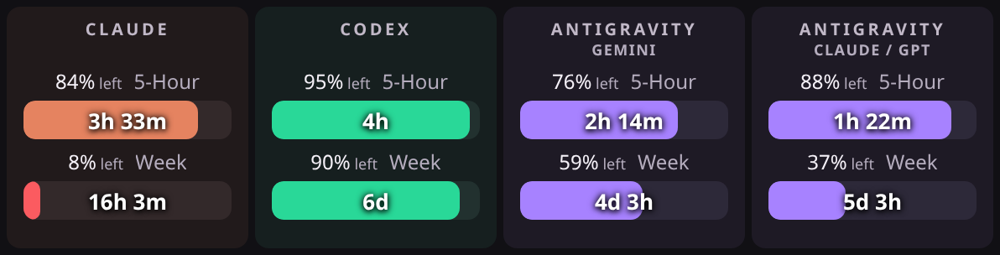

# CodexBar Floating Widget for macOS

Keep compact usage cards over your work while another app has focus. The panel joins
your Spaces and can appear alongside full-screen apps. Each card shows the first two
visible quota windows, a percentage, and time until reset. Bars and percentages
follow CodexBar's **Usage bars fill** setting. It starts with Claude, Codex, and
Antigravity. When Antigravity reports its Claude/GPT quota windows, they get a
separate card for the 5-hour and weekly limits, including at zero usage.



The companion uses TypeScript for the widget and AppKit for the floating panel.
Install it as a separate macOS app. CodexBar's **Settings → Plugins** installs
provider scripts, which have no access to macOS windows.

## Install

Requires macOS 14+, CodexBar with the managed HTTP server and Dashboard v1 API,
Node.js, and Xcode 16 or newer Command Line Tools for Swift 6. Node.js and the
compiler are only needed at install time.

1. In CodexBar, enable the providers you want to see.
2. In **Settings → Advanced → HTTP server**, enable the server, keep **Bind address**
   set to `127.0.0.1` (or `localhost`), generate a token, and click **Apply**.
3. From this repository's root on your Mac, run:

   ```bash
   ./Integrations/FloatingWidget/install.sh
   open "$HOME/Applications/CodexBar Floating Widget.app"
   ```

The installer builds and signs the app locally and installs it in `~/Applications`.
To upgrade, quit the floating widget and rerun the same installer. To uninstall,
quit it and move **CodexBar Floating Widget.app** from `~/Applications` to the Trash.

## Use the widget

- Drag anywhere on the widget to move it. The app remembers its position.
- Right-click or Control-click the widget, or click the chart icon in the menu bar,
  to open its controls. Choose **Reload Usage** to check the server immediately.
  If the server is unavailable, the widget retries every ten seconds after each
  failed request.
- Choose **Hide Menu Bar Icon** to keep only the widget, or **Show Menu Bar Icon**
  from the widget's menu to bring it back. The setting is saved across launches.
- **Hide Widget** pauses its usage requests. If both the widget and the icon are
  hidden, open **CodexBar Floating Widget.app** again to show the panel.
- Choose **Choose Providers…** in the same menu and enter one to three provider IDs
  in the order you want. See the [provider IDs](../../docs/provider-ids.md).
- Keep CodexBar running. The widget requests a new dashboard snapshot roughly once
  a minute and updates the countdowns between requests. **Last known** indicates
  cached or stale usage. **Reset due** means a reported reset time has passed and
  the widget is waiting for a new reading.

The app reads the managed server's `http-server.json` next to your CodexBar config
and sends its token to the loopback server. It accepts the configured port, and
reloads the settings for each request. If you use `CODEXBAR_CONFIG` or
`XDG_CONFIG_HOME`, launch both apps with the same environment. The widget renders
quota figures without account names. CodexBar handles provider requests and caching.
See the [Dashboard API](../../docs/dashboard-api.md).
